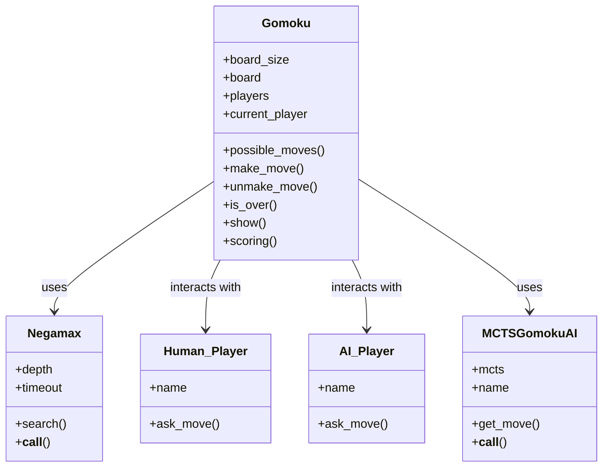

# Gomoku Game Project: Code Documentation

## Table of Contents
1. [Project Overview](#project-overview)
2. [Architecture Diagram](#architecture-diagram)
3. [AI Algorithms](#ai-algorithms)
4. [Player Classes](#player-classes)
5. [Main Game Class: Gomoku](#main-game-class-gomoku)
6. [Helper Methods](#helper-methods)
7. [Usage Examples](#usage-examples)

---

## Project Overview

This project implements the classic board game **Gomoku** (Five in a Row) with support for human and AI players. The AI uses advanced search algorithms (Negamax with alpha-beta pruning, SSS*, and Monte Carlo Tree Search) and supports adjustable difficulty. The game can be played in the terminal, and may also have a web interface (see `app.py`).

---

## Architecture Diagram



---

## AI Algorithms

### Negamax (with Alpha-Beta Pruning, Transposition Table, Iterative Deepening)

- **Class:** `Negamax`
- **Inherits:** `easyAI.Negamax`
- **Purpose:** Finds the best move for the AI using a depth-limited search, alpha-beta pruning, and a transposition table for efficiency. Supports iterative deepening and timeouts.
- **Key Methods:**
  - `__init__(depth, scoring, win_score, tt, timeout)`: Initializes the algorithm with search depth, scoring function, win score, transposition table, and optional timeout.
  - `is_timeout()`: Checks if the search has exceeded the allowed time.
  - `search(game, depth, alpha, beta)`: Performs the search with alpha-beta pruning.
  - `__call__(game)`: Entry point for the AI to select a move, using iterative deepening.

**Usage:**  
Used by `AI_Player` to select moves for the AI. Timeout ensures the AI doesn't take too long per move.

---

### SSS* Algorithm

- **Class:** `SSS` (imported from `sss_algorithm.py`)
- **Purpose:** Alternative AI search algorithm, also supports depth and timeout.
- **Usage:**  
Used by `SSS_AI_Player` when the user selects the SSS* algorithm.

---

### Monte Carlo Tree Search (MCTS)

- **File:** `monte_carlo_algorithm.py`
- **Purpose:** Probabilistic search algorithm that uses random simulations to evaluate game positions
- **Algorithm:** MCTS builds a search tree through four phases: Selection, Expansion, Simulation, and Backpropagation
- **Advantages:** Doesn't require domain-specific heuristics, can handle large search spaces effectively

#### Key Classes

##### `MCTSNode`
- **Purpose:** Represents a node in the MCTS search tree
- **Attributes:**
  - `state`: Game board state
  - `parent`: Parent node reference
  - `children`: List of child nodes
  - `visits`: Number of times this node has been visited
  - `wins`: Accumulated win score
  - `untried_moves`: Moves not yet explored from this node

- **Key Methods:**
  - `get_legal_moves()`: Returns all empty cells as possible moves
  - `is_fully_expanded()`: Checks if all moves have been tried
  - `is_terminal()`: Checks if game is over (win/draw)
  - `check_winner()`: Determines winner by checking five-in-a-row patterns
  - `ucb1_value(exploration_constant)`: Calculates Upper Confidence Bound for node selection
  - `select_child()`: Selects child with highest UCB1 value
  - `expand(current_player)`: Adds new child node for untried move
  - `simulate(current_player)`: Plays random game to completion
  - `backpropagate(result, player)`: Updates statistics up the tree

##### `MonteCarloTreeSearch`
- **Purpose:** Main MCTS algorithm implementation
- **Parameters:**
  - `exploration_constant`: UCB1 exploration parameter (default: √2 ≈ 1.414)
  - `max_iterations`: Maximum number of MCTS iterations
  - `time_limit`: Maximum search time in seconds

- **Key Methods:**
  - `search(board_state, current_player)`: Main MCTS loop
  - `_select(node)`: Selection phase - navigate down tree using UCB1
  - `_expand(node, current_player)`: Expansion phase - add new child
  - `_simulate(node, current_player)`: Simulation phase - random playout
  - Returns move leading to most visited child

##### `MCTSGomokuAI`
- **Purpose:** High-level interface for using MCTS in Gomoku
- **Features:**
  - Configurable iteration count and time limits
  - Compatible interface with other AI algorithms
  - Standalone implementation (no dependency on gomoku.py)

#### MCTS Algorithm Phases

1. **Selection**: Navigate down the tree using UCB1 to balance exploration vs exploitation
2. **Expansion**: Add a new child node for an unexplored move
3. **Simulation**: Play out a random game from the new node to completion
4. **Backpropagation**: Update win/visit statistics back up to the root

#### UCB1 Formula
```
UCB1 = (wins/visits) + c * √(ln(parent_visits)/visits)
```
Where `c` is the exploration constant that balances exploitation vs exploration.

#### Usage Example
```python
from monte_carlo_algorithm import MCTSGomokuAI, create_empty_board

# Create AI with custom parameters
ai = MCTSGomokuAI(max_iterations=1000, time_limit=5.0)

# Create empty board
board = create_empty_board(15)

# Get AI move
move = ai.get_move(board, player=1)
```

---

## Player Classes

### Human_Player

- **Class:** `Human_Player`
- **Inherits:** `easyAI.Human_Player`
- **Purpose:** Handles user input for moves.
- **Key Features:**
  - Prompts the user for a move using 1-based indexing (user-friendly).
  - Converts input to 0-based indexing for internal logic.
  - Validates input and provides error messages.

### AI_Player

- **Class:** `AI_Player`
- **Inherits:** `easyAI.AI_Player`
- **Purpose:** Uses the Negamax algorithm to select moves for the AI.
- **Key Features:**
  - Accepts an AI algorithm instance (e.g., Negamax).
  - Returns the move selected by the AI.

### SSS_AI_Player

- **Class:** `SSS_AI_Player`
- **Purpose:** Uses the SSS* algorithm to select moves for the AI.
- **Key Features:**
  - Accepts an SSS* algorithm instance.
  - Returns the move selected by the SSS* AI.

---

## Main Game Class: Gomoku

### Class: `Gomoku` (inherits from `easyAI.TwoPlayerGame`)

#### Initialization

- **`__init__(board_size, difficulty, players, ai_algorithm)`**
  - Sets up the board, players, and AI algorithm.
  - Board is a 2D list of size `board_size x board_size`.
  - Players: List of two player objects (human and AI).
  - AI algorithm: "negamax", "sss", or "mcts".

#### Game Logic

- **`possible_moves()`**  
  Returns a list of all empty cells as possible moves.

- **`make_move(move)`**  
  Places the current player's stone at the specified position.

- **`unmake_move(move)`**  
  Removes a stone from the specified position (used by AI for search).

- **`lose()`**  
  Checks if the opponent has formed five in a row.

- **`is_over()`**  
  Checks if the game is over (win or draw).

- **`show()`**  
  Prints the board to the terminal, using colored symbols and 1-based indexing.

- **`scoring()`**  
  Evaluates the board for the current player using a heuristic:
    - 5 in a row: 10000 points
    - 4 in a row (open): 1000 points
    - 3 in a row (open): 100 points
    - 2 in a row (open): 10 points
    - 1 in a row: 1 point
    - Negative values for opponent's lines

- **`_evaluate_board(player)`**  
  Helper for `scoring()`, evaluates all rows, columns, and diagonals for a player.

- **`_evaluate_line(line, player)`**  
  Helper for `scoring()`, evaluates a line of 5 cells.

- **`five_in_a_row(opponent)`**  
  Checks if the specified player has five stones in a row.

- **`__str__()`**  
  Returns a string representation of the board with colored pieces and 1-based indexing.

- **`ttentry()`**  
  Returns a hashable representation of the board and current player for use in the transposition table.

- **`play(verbose=True)`**  
  Main game loop. Handles user interaction, move selection, board display, and win/draw detection.

---

## Helper Methods

- **Input Handling:**  
  Human input is always 1-based for user-friendliness, but converted to 0-based for internal logic.

- **Board Display:**  
  Uses ANSI color codes for colored pieces in the terminal. Board is always shown with 1-based row/column numbers.

- **Transposition Table:**  
  Used by AI to cache board states and speed up search.

---

## Usage Examples

### Starting a New Game (Terminal)

```bash
python gomoku.py
```

- You will be prompted for board size (9, 13, 15, or 19), difficulty (1-5), and your name.
- The game will display the rules and start the match.
- Enter moves as "row col" (e.g., "2 3" for row 2, column 3).

### Testing Monte Carlo Tree Search

```bash
python monte_carlo_algorithm.py
```

- Runs a demo showing MCTS AI making moves on a 9x9 board.
- Displays board state after each move with timing information.

### Customizing AI

- The AI difficulty can be set from 1 (easiest) to 5 (hardest).
- The AI algorithm can be switched to SSS* by passing `ai_algorithm="sss"` when creating the `Gomoku` object in code.
- MCTS can be used independently with configurable parameters.

---

## Web Interface (app.py)

### Flask Web Application

- **Framework:** Flask with CORS support
- **Purpose:** Provides a web-based interface for playing Gomoku
- **Key Features:**
  - RESTful API for game operations
  - Static file serving for frontend assets
  - Game state management
  - AI integration for web play

### API Endpoints

#### `/api/new_game` (POST)
- **Purpose:** Creates a new game instance
- **Parameters:** 
  - `boardSize` (default: 15): Size of the game board
  - `difficulty` (default: 3): AI difficulty level (1-5)
- **Returns:** Game ID and confirmation message

#### `/api/make_move` (POST)
- **Purpose:** Processes player moves and AI responses
- **Parameters:**
  - `gameId`: Unique game identifier
  - `row`, `col`: Move coordinates (0-based)
  - `opponent`: "ai" for AI opponent
- **Logic:**
  1. Validates and applies player move
  2. Checks for game over conditions
  3. If playing against AI, generates and applies AI move
  4. Returns updated board state and game status

#### `/api/reset` (POST)
- **Purpose:** Resets an existing game
- **Parameters:** Game ID, board size, difficulty
- **Returns:** Confirmation message

#### `/api/benchmark` (POST)
- **Purpose:** Runs AI performance benchmarks
- **Parameters:** Algorithm type, board size, difficulty, trial count
- **Returns:** Performance metrics (average time per move)

### Game State Management
- **Storage:** In-memory dictionary (`games = {}`)
- **Game IDs:** Sequential string identifiers
- **Board Representation:** 2D arrays of integers (0=empty, 1=player1, 2=player2)

### Port Management
- **Dynamic Port Finding:** `find_free_port()` function
- **Default Range:** 5002-5011
- **Environment Support:** Reads `PORT` environment variable

---

## SSS* Algorithm (sss_algorithm.py)

### Class: `SSS`

- **Purpose:** Alternative AI search algorithm to Negamax
- **Algorithm:** SSS* (Secondary Search Strategy) - best-first search
- **Advantages:** Can outperform alpha-beta pruning in certain game positions

### Key Methods

#### `__init__(depth, scoring, win_score, tt, timeout)`
- **Parameters:**
  - `depth`: Maximum search depth
  - `scoring`: Board evaluation function
  - `win_score`: Score for winning positions (default: 100000)
  - `tt`: Transposition table for caching
  - `timeout`: Time limit per move (default: 10 seconds)

#### `__call__(game)`
- **Purpose:** Main entry point for move selection
- **Process:**
  1. Iterates through all possible moves
  2. Evaluates each move using `sss_star()` recursive search
  3. Returns move with highest evaluation score
  4. Includes timeout handling and early termination for winning moves

#### `sss_star(game, alpha, beta, depth)`
- **Purpose:** Recursive search implementation
- **Features:**
  - Alpha-beta pruning for efficiency
  - Transposition table lookup and storage
  - Timeout checking to prevent infinite search
  - Game state copying for move simulation

### Performance Optimizations
- **Transposition Table:** Caches previously evaluated positions
- **Alpha-Beta Pruning:** Eliminates unnecessary search branches
- **Timeout Management:** Prevents excessive computation time
- **Early Termination:** Stops search when winning move is found

---

## Web Audio System (static/js/web-audio-sounds.js)

### Audio Context Management

#### `initAudio()`
- **Purpose:** Initializes Web Audio API with browser compatibility
- **Features:**
  - Handles browser prefixes (`webkitAudioContext`)
  - Manages suspended audio context states
  - Requires user interaction for audio activation (browser security)

### Sound Effects

#### `playStoneSound()`
- **Purpose:** Sound when placing a stone on the board
- **Implementation:**
  - Sine wave oscillator (500Hz → 300Hz frequency sweep)
  - 0.2-second duration with exponential volume fade
  - Creates realistic "click" sound effect

#### `playWinSound()`
- **Purpose:** Victory celebration sound
- **Implementation:**
  - C major arpeggio (C5, E5, G5, C6 notes)
  - Sequential note playback (0.15s per note)
  - Ascending musical pattern for positive feedback

#### `playDrawSound()`
- **Purpose:** Game draw notification
- **Implementation:**
  - Descending tone (A4 440Hz → A3 220Hz)
  - 0.5-second duration
  - Neutral emotional tone

#### `playErrorSound()`
- **Purpose:** Invalid move indication
- **Implementation:**
  - Square wave oscillator (150Hz)
  - Short duration (0.2s) with lower volume
  - Buzzy, electronic sound for negative feedback

#### `playEnhancedStoneSound()`
- **Purpose:** Alternative stone placement sound with resonance
- **Implementation:**
  - Triangle wave for richer harmonics
  - Low-pass filter with resonance (Q=8)
  - More realistic stone placement audio

### Browser Compatibility

#### `initSoundSystem()`
- **Purpose:** Handles browser support detection and fallbacks
- **Features:**
  - Detects Web Audio API support
  - Provides silent mode fallbacks for unsupported browsers
  - Handles user interaction requirements for audio activation

### Audio Architecture
- **Nodes:** Oscillator → Filter → Gain → Destination
- **Frequency Control:** Real-time frequency modulation
- **Volume Envelopes:** Exponential gain ramping for natural sound decay
- **Error Handling:** Graceful degradation with console warnings

---

## File Relationships and Dependencies

### Core Game Files
- **`gomoku.py`**: Main game logic, AI, and CLI interface
- **`sss_algorithm.py`**: SSS* AI algorithm implementation
- **`monte_carlo_algorithm.py`**: Standalone MCTS implementation
- **`app.py`**: Flask web server and API endpoints

### Frontend Files
- **`index.html`**: Main web interface (referenced but not examined)
- **`static/js/web-audio-sounds.js`**: Audio system for web interface
- **`static/js/sounds.js`**: Alternative audio implementation

### Configuration and Documentation
- **`game_rules.md`**: Game rules displayed at startup
- **`requirements.txt`**: Python dependencies
- **`ARCHITECTURE.md`**: High-level design overview
- **`README.md`**: Installation and setup instructions

### Testing and Benchmarking
- **`test_*.py`**: Unit tests for various components
- **`benchmark.py`**: Comprehensive AI performance testing
- **`quick_benchmark.py`**: Fast AI benchmarking
- **`benchmark.html`**: Web-based benchmark interface
- **`benchmark_dashboard.js`**: Benchmark visualization

### Utility Files
- **`run_game.sh`**: Shell script for easy game launching
- **`.gitignore`**: Git ignore patterns
- **`LICENSE`**: Project license information

---

## Integration Points

### Game Engine ↔ Web Interface
- **`app.py`** imports **`gomoku.py`** classes
- **API endpoints** create and manage **`Gomoku`** instances
- **Move validation** uses game logic from core engine

### AI Algorithms ↔ Game Engine
- **`Gomoku`** class supports **Negamax**, **SSS***, and potentially **MCTS** algorithms
- **Algorithm selection** via `ai_algorithm` parameter
- **Timeout handling** prevents AI from taking too long
- **MCTS** can be used independently without game engine integration

### Frontend ↔ Backend
- **RESTful API** communication between web interface and Flask server
- **JSON data exchange** for moves, game state, and configuration
- **Real-time audio feedback** enhances user experience

---

## Algorithm Comparison

### Negamax vs SSS* vs MCTS

| Feature | Negamax | SSS* | MCTS |
|---------|---------|------|------|
| **Search Type** | Minimax with pruning | Best-first search | Monte Carlo simulation |
| **Evaluation** | Requires heuristic function | Requires heuristic function | No heuristic needed |
| **Memory Usage** | Moderate (with transposition table) | Moderate | High (tree storage) |
| **Strength** | Strong with good heuristics | Can outperform Negamax | Adapts to any position |
| **Time Complexity** | Exponential (pruned) | Exponential (pruned) | Anytime algorithm |
| **Implementation** | Complex (pruning logic) | Complex (best-first) | Moderate |

---

## Further Reading

- See `ARCHITECTURE.md` for a high-level design overview
- See `README.md` for installation and setup instructions
- See `game_rules.md` for detailed game rules
- See `unittest_plan.md` for testing strategy
- See `README_Benchmark.md` for performance testing details

---
